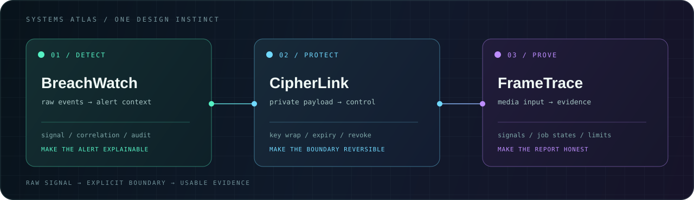

<div align="center">
  
</div>

<p align="center">
  <a href="https://yashpathak007.github.io">PORTFOLIO</a>
  &nbsp;·&nbsp;
  <a href="https://github.com/YashPathak007?tab=repositories">REPOSITORIES</a>
  &nbsp;·&nbsp;
  <a href="mailto:yashpathak1973@gmail.com">CONTACT</a>
</p>

# Yash Pathak

> **I turn messy, high-stakes workflows into systems you can inspect, trust, and act on.**

Security-minded product engineer building software where **state is visible, boundaries are explicit, and evidence survives the handoff**.

```console
$ ./profile --signal
identity    yash@systems-lab
mode        security-minded product engineering
loop        detect → define boundary → prove the workflow
building    explainable products with honest failure states
```

## The systems lab

Three focused systems, one design instinct: move from raw signal to a decision someone can defend.

<div align="center">
  
</div>

### [`BreachWatch`](https://github.com/YashPathak007/BreachWatch) / `DETECT → INVESTIGATE`

Turns normalized security events into explainable alert investigations—with correlated evidence, role boundaries, and an audit trail.

`React` `FastAPI` `PostgreSQL` · `RBAC` · `alert lifecycle`

### [`CipherLink`](https://github.com/YashPathak007/CipherLink) / `PROTECT → REVOKE`

Makes private file exchange legible: encrypted payloads, wrapped keys, expiry, and revocation are part of the workflow—not hidden afterthoughts.

`React` `Node.js` `PostgreSQL` · `AES-256-GCM` · `path-traversal regression`

### [`FrameTrace`](https://github.com/YashPathak007/FrameTrace) / `MEASURE → REPORT`

Turns media review into a bounded evidence report with measurable signals, explicit job states, and limitations that stay visible.

`React` `FastAPI` `OpenCV` `PyTorch` · `deterministic behavior` · `supported-media classification`

## Stack matrix

| Layer | Working set |
| --- | --- |
| **Product** | `TypeScript` · `React` |
| **Services** | `Node.js` · `Python` · `FastAPI` |
| **Data / runtime** | `PostgreSQL` · `Redis` · `Docker` |
| **Analysis** | `OpenCV` · `PyTorch` |
| **Operating principle** | visible state · explicit boundaries · repeatable checks |

## Proof stays near the claim

I validate the behavior each system asks a user to trust:

- **BreachWatch** — authentication, RBAC, ingestion, detection, alert lifecycle, audit records, and frontend/build checks.
- **CipherLink** — encryption/decryption, tamper rejection, upload/share constraints, and a path-traversal regression check.
- **FrameTrace** — deterministic model behavior, supported-media classification, explicit limitation language, and a frontend production build check.

## Current direction

- Make queued, processing, empty, failed, and completed states impossible to misread.
- Put security boundaries and model limitations where decisions happen.
- Prefer repeatable tests and build checks over decorative metrics.

## Open a channel

Start with the [portfolio](https://yashpathak007.github.io), inspect a system's README, or [send a message](mailto:yashpathak1973@gmail.com) about a workflow worth making explainable.

<p align="center">
  <sub>BUILD SYSTEMS THAT EXPLAIN THEMSELVES · YP/007</sub>
</p>
