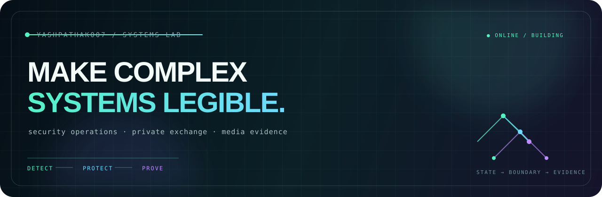

<div align="center">
  
</div>

<p align="center">
  <a href="https://yashpathak007.github.io">PORTFOLIO</a>
  &nbsp;·&nbsp;
  <a href="https://github.com/YashPathak007?tab=repositories">REPOSITORIES</a>
  &nbsp;·&nbsp;
  <a href="mailto:yashpathak1973@gmail.com">CONTACT</a>
</p>

# Yash Pathak

> I build security-minded systems that make state, boundaries, and evidence visible.

I turn complex workflows into products people can inspect and validate—from detection to investigation, protected storage to revocation, and media input to evidence report.

```text
$ identity --show
name       Yash Pathak
focus      security operations · private exchange · media evidence
method     make state visible → define the boundary → prove the workflow
status     building explainable products
```

## Featured systems

### [BreachWatch](https://github.com/YashPathak007/BreachWatch)
Turn normalized security events into explainable alert investigations.

**Engineering signal:** `React` `FastAPI` `PostgreSQL` · RBAC · correlated evidence · audit trail

### [CipherLink](https://github.com/YashPathak007/CipherLink)
Make private file sharing rules visible, reversible, and auditable.

**Engineering signal:** `React` `Node.js` `PostgreSQL` · AES-256-GCM · wrapped keys · expiry and revocation

### [FrameTrace](https://github.com/YashPathak007/FrameTrace)
Turn media review into a bounded, inspectable evidence report.

**Engineering signal:** `React` `FastAPI` `OpenCV` `PyTorch` · measurable signals · explicit job states · honest limitations

## Stack

**Build:** `TypeScript` · `React` · `Node.js` · `Python` · `FastAPI`

**Data & delivery:** `PostgreSQL` · `Redis` · `Docker`

**Analysis:** `OpenCV` · `PyTorch`

## Proof / validation

Validation stays close to the product claim in each repository:

- **BreachWatch** — authentication, RBAC, ingestion, detection, alert lifecycle, audit records, and frontend/build checks.
- **CipherLink** — encryption/decryption, tamper rejection, upload/share constraints, and a path-traversal regression check.
- **FrameTrace** — deterministic model behavior, supported-media classification, explicit limitation language, and a frontend production build check.

## Current focus

- Make queued, processing, empty, failed, and completed states legible.
- Put security boundaries and limitations where decisions happen.
- Prefer repeatable tests and build checks over decorative metrics.

## Start here

Explore the [portfolio](https://yashpathak007.github.io), open a system's README, or [get in touch](mailto:yashpathak1973@gmail.com) about a workflow worth making explainable.

<p align="center">
  <sub>BUILD SYSTEMS THAT EXPLAIN THEMSELVES.</sub>
</p>
